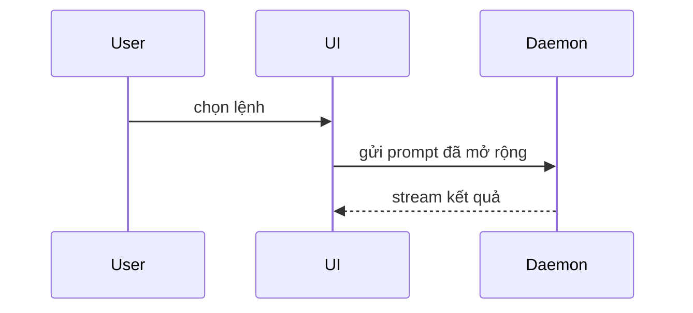

Dùng mẫu này khi viết body cho PR:

```markdown
## Tóm tắt

<sơ đồ, phác thảo diff, hoặc cây>

## Bằng chứng

- **Trước:** <ảnh chụp màn hình/output/lần chạy test fail>
  **Sau:** <ảnh chụp màn hình/output/lần chạy test pass>

## Rủi ro khi merge

**Loại cửa:** <một chiều hoặc hai chiều>

<tuỳ chọn: mô tả>

**Phạm vi ảnh hưởng:** <mô tả bằng một từ>

<tuỳ chọn: các hệ quả có thể xảy ra khi merge>
```

## Các mục

Bỏ hết phần mở đầu và viết thật ngắn. Dùng ngôn ngữ domain của user lấy từ `GLOSSARY.md`.

Viết body PR bằng **tiếng Việt**, giữ nguyên các heading trong mẫu. Dùng từ tiếng Anh khi nó diễn đạt chính xác hơn hoặc là thuật ngữ chuyên ngành (tên API, pattern, lệnh, tên biến, *race condition*, *migration*…), vì dịch gượng những từ này làm reviewer khó đối chiếu với code.

### Tóm tắt

Chọn cách thể hiện nhỏ nhất mà vẫn làm rõ ý chính.

- Thể hiện logic hoặc thuật toán bằng pseudocode:

```text
on(save)
  if content is unchanged
    return cached result
  write new content
  return fresh result
```

- Thể hiện luồng điều khiển lúc chạy bằng cây lời gọi (call tree):

```text
submitForm
  createSession
    persistPrompt
    launchAgent
  navigateToSession
```

- Thể hiện cấu trúc UI bằng cây component, kèm state và ranh giới module nào quan trọng:

```text
<SessionPage> (apps/example/src/routes/session.tsx)
  useSessionEvents()
  <SessionToolbar>
    <RunSkillButton> (packages/ui)
```

- Thể hiện trách nhiệm của file hoặc một đợt refactor rộng bằng cây file nông:

```text
src/
├── commands/       # phân tích thao tác của user
├── sessions/       # sở hữu state của session
└── transport/      # gửi request API
```

- Thể hiện tương tác giữa các component, luồng điều khiển hoặc luồng dữ liệu bằng Mermaid:



- Dùng `diff` khi ý chính là cái gì thay đổi và hình dạng xung quanh đã có sẵn. Chọn kiểu diff khớp với chủ đề.

Với thay đổi component:

```diff
 <SessionPage>
   useSessionEvents()
   <SessionToolbar>
+    <RunSkillButton />
   <SessionTimeline>
+    <SkillResultCard />
```

Với thay đổi bố cục file:

```diff
 src/
 ├── commands/
+│   └── show-me.ts       # mở rộng lệnh slash
 ├── sessions/
-└── transport.ts
+└── transport/
+    ├── client.ts
+    └── stream.ts
```

Với thay đổi cây lời gọi hoặc call stack:

```diff
 submitForm
   createSession
     persistPrompt
+    expandSkillMention
     launchAgent
-  navigateToSession
+  navigateToSession
+    subscribeToEvents
```

Với thay đổi state hoặc luồng điều khiển:

```diff
 on(save)
-  write content
+  if content is unchanged
+    return cached result
+  write new content
+  invalidate cache
```

- Hiển thị cả khối code khi phần lớn là mới, khi lược bớt ngữ cảnh sẽ che mất quyền sở hữu hoặc thứ tự, hoặc khi user cần một hình dạng đích để copy:

```ts
function expandSkill(command: string): string {
  const skillName = command.slice(1);
  return `use the ${skillName} skill`;
}
```

#### Hướng dẫn

Đặt mỗi hình minh hoạ ngay cạnh đoạn chữ ngắn mà nó hỗ trợ. Chỉ giữ lại những lời gọi, file, prop, state và ranh giới cần thiết để trả lời câu hỏi hiện tại của user hoặc các phương án để giải quyết điểm đang thảo luận.

Bạn có thể dùng một trong các cách trên, có thể dùng vài cách, nhưng khó mà dùng hết. Hãy tự phán đoán và đừng làm user bị ngợp.

### Bằng chứng

Bằng chứng cụ thể cho thấy thay đổi hoạt động. Đưa ra trước và sau.

Ảnh chụp màn hình là hạng S - khi môi trường đã sẵn sàng cho việc đó và thay đổi là thay đổi về giao diện.

Bằng chứng dựa trên việc chạy thực tế là hạng A. Kết quả test, output console. Chỉ ra đúng test trước thì fail và giờ thì pass, viết bằng pseudocode.

### Rủi ro khi merge

Mô tả đây là cửa một chiều hay cửa hai chiều. Bạn có thể quay lui qua cửa hai chiều, nhưng không thể với cửa một chiều. Một PR rollback rẻ thì rủi ro thấp hơn. Những thay đổi có hành động phá huỷ dữ liệu hoặc quyết định khó đảo ngược là cửa một chiều.

Phạm vi ảnh hưởng (blast radius) là mức tác động hoặc phạm vi tiềm tàng của các thay đổi mà PR này đưa vào. Cân nhắc mọi khả năng. Ví dụ như xô lệch layout, làm hỏng phía sử dụng (consumer), khả năng hiển thị trên mobile, v.v.
